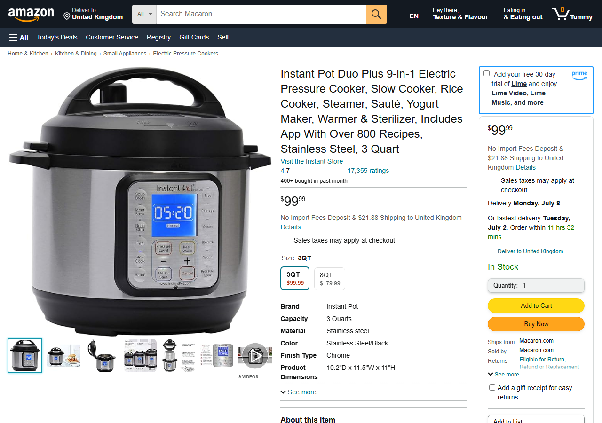
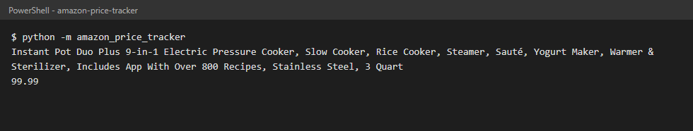
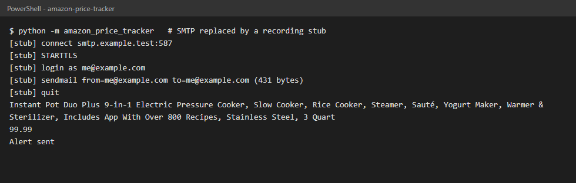
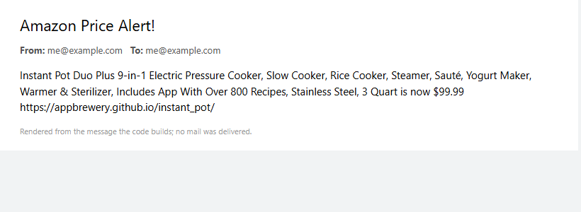
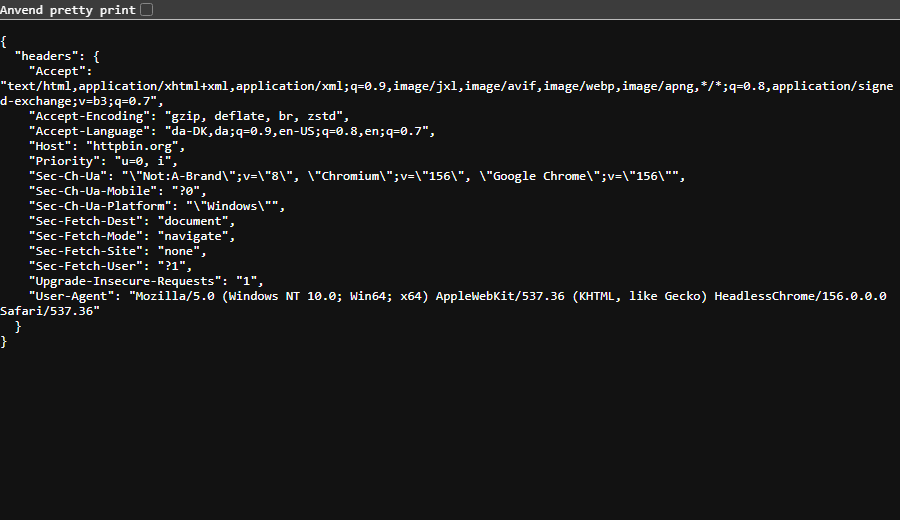
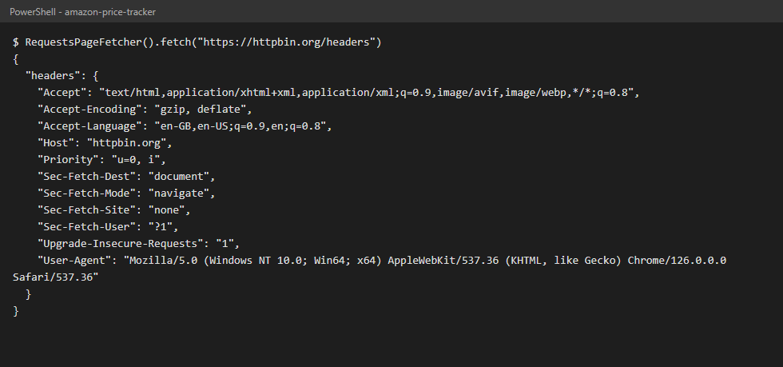
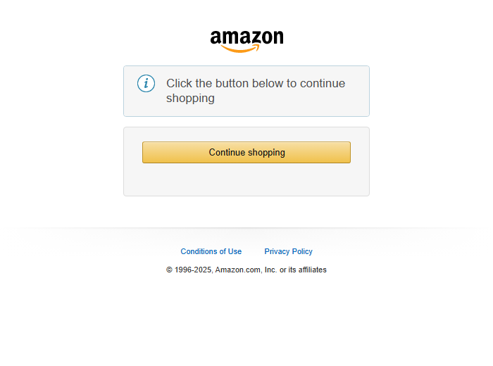
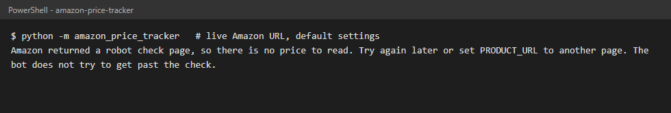

# 🚀 Amazon Price Tracker

A Python bot for Day 47 of Udemy's "100 Days of Code: The Complete Python Pro Bootcamp": it reads a product page, extracts the price and sends an e-mail alert when the price drops below a target. Made for course participants who want to compare solutions and for visitors who browse for ideas.

## 📚 Table of Contents

- [Overview](#-overview)
- [Requirements](#-requirements)
- [Setup](#-setup)
- [Run](#-run)
- [Tests](#-tests)
- [License](#-license)
- [Links](#-links)
- [Appendix: Project documents](#-appendix-project-documents)

## 🧭 Overview

The assignment is built in four lecture steps. Each step was delivered on its own branch and pull request, and each has a screenshot and a [wiki](#-links) page in English, Danish and Bahasa Malaysia that explains what it teaches.

| Step | What it adds | Status |
| --- | --- | --- |
| 1 | Scrape the price from the practice page with BeautifulSoup | done |
| 2 | E-mail alert below the target price, secrets in `.env` | done |
| 3 | Browser-like request headers | done |
| 4 | The live Amazon page | done (Amazon answers with a robot check, see below) |

### Step 1: scrape the price

`get_title(html)` and `get_price(html)` in `src/amazon_price_tracker/infrastructure/scraper.py` use BeautifulSoup on the [practice page](https://appbrewery.github.io/instant_pot/). The price element has the class `a-offscreen` and its text is `$99.99`; `split("$")` removes the currency sign and `float()` returns `99.99`.





### Step 2: e-mail alert below the target

`check_price` in `src/amazon_price_tracker/application/alert.py` compares the price with `TARGET_PRICE` (100) from `constants.py`. When it is lower, `SmtpNotifier` (`infrastructure/mailer.py`) connects to your SMTP server on port 587, starts TLS, logs in and sends a message with the title, the price and the link to buy. The SMTP address, e-mail address and password come from your own `.env` through `python-dotenv`, so they never appear in the code. The practice page costs 99.99, so a target of 100 triggers the alert.

The screenshots below come from a run where the SMTP connection is replaced by a recording stub, so no mail is sent; the second image is rendered from the message the code builds.





### Step 3: request headers

A browser sends headers with every request: the browser and system (`User-Agent`), the preferred language (`Accept-Language`) and more. A bare script sends almost none, so a server can answer in the wrong language or currency, or treat the request as a bot. `DEFAULT_HEADERS` in `constants.py` holds the browser-like set (without `Host` and `X-Amzn-Trace-Id`, as the lecture says) and `RequestsPageFetcher` passes it as `headers=` to `requests.get`.

What a browser sends to [httpbin.org/headers](https://httpbin.org/headers), and what the bot sends (`Host` is added by `requests` itself):





### Step 4: the live Amazon page

The default product is the lecture's Amazon page (`AMAZON_URL` in `constants.py`). On 2026-10-28 the bot asked for it with the Step 3 headers and Amazon answered HTTP 200 with a robot-check page ("Click the button below to continue shopping") instead of the product, so there was no price to read. This is the outcome the lecture warns about: live pages change and Amazon may refuse scripts.

The bot recognises that page (`is_robot_check` in `infrastructure/scraper.py`), stops with a clear message and does **not** try to solve or get past the check. The price and title selectors are listed in `constants.py` (`PRICE_SELECTORS`, `TITLE_SELECTORS`), so they are easy to change when Amazon changes its markup. Set `PRODUCT_URL` in your `.env` to track another page, for example the practice page `https://appbrewery.github.io/instant_pot/`, where Steps 1 to 3 work.





Repository layout:

| Path | What it is for |
| --- | --- |
| `src/amazon_price_tracker/` | The package; `constants.py` is the only place for constants |
| `tests/` | `pytest` tests; they never use the network or a real mail server |
| `docs/` | Project documents (Business Case, plan, milestones, reviews) and the wiki pages |
| `Doxyfile` | Doxygen configuration for the source comments |
| `.env.example` | The settings you put in your own `.env` |

## 📋 Requirements

- Python 3.13 or newer.
- Runtime packages (installed by `pip`): `requests`, `beautifulsoup4`, `python-dotenv`. Nothing else is needed to run the bot.
- Optional, for development: `pytest`, `ruff`, `mypy` (the `dev` extra) and [Doxygen](https://www.doxygen.nl/) for the API documentation.

## 🛠️ Setup

Create a local virtual environment named `.venv`, activate it and upgrade `pip`:

```bash
python -m venv .venv
```

Activate it (Linux and macOS):

```bash
source .venv/bin/activate
```

Activate it (Windows PowerShell):

```powershell
.venv\Scripts\Activate.ps1
```

Activate it (Windows Git Bash):

```bash
source .venv/Scripts/activate
```

Upgrade `pip` and install the project with the development tools:

```bash
python -m pip install --upgrade pip
```

```bash
python -m pip install -e ".[dev]"
```

For use without development tools, install with `python -m pip install -e .`.

Create your own settings file from the example and fill in the values. `.env` is ignored by git; never commit it:

```bash
cp .env.example .env
```

Gmail needs 2-Step Verification and an App Password; use the App Password as `EMAIL_PASSWORD`. SMTP addresses: Gmail `smtp.gmail.com`, Hotmail `smtp.live.com`, Outlook `outlook.office365.com`, Yahoo `smtp.mail.yahoo.com`. The bot connects on port 587.

## ▶️ Run

Fill in your `.env` first (see Setup), then start the bot. It reads the product at `PRODUCT_URL` (the Amazon page unless you set another one), prints the title and the price and sends the alert when the price is below the target. Amazon currently answers with a robot check, so to see the alert work set `PRODUCT_URL="https://appbrewery.github.io/instant_pot/"` in `.env`:

```bash
python -m amazon_price_tracker
```

## 🧪 Tests

```bash
python -m pytest
```

Lint and type checks:

```bash
ruff check .
```

```bash
mypy
```

Build the API documentation (written to `docs/doxygen/`, which is git-ignored):

```bash
doxygen Doxyfile
```

## 📄 License

GNU Affero General Public License v3.0, see [LICENSE](LICENSE).

## 🔗 Links

- [Repository][repository]
- [Documentation][documentation]
- [Issue tracker][issues]
- [Wiki in English, Danish and Bahasa Malaysia][wiki] (what we gained in each lecture step; the pages are in [`docs/wiki/`](docs/wiki/))

## 📎 Appendix: Project documents

The documents a newcomer needs, in reading order.

| Document | What it tells you |
| --- | --- |
| [AGENTS.md][agents] | The rules AI agents follow in this repository |
| [Business Case][BC-001] | Why the project exists, its scope and success criteria |
| [Stakeholder Analysis][SA-001] | Who is involved; the stakeholder IDs used for owners and reviewers |
| [Project Plan][PP-001] | The gateways and their schedule |
| [Milestones][milestones] | One document per gateway: Go/No-Go criteria and tasks |
| [Artifact registry][registry] | Where each artifact type lives, the next version, the PO language and domain |
| [Framework README][framework-readme] | The framework this project uses |
| [Framework changelog][framework-changelog] | What changed in each framework release |

---

[repository]: https://git.tirsystem.com/Tirsvad-Udemy-100-days-of-code/047-amazon-price-tracker
[documentation]: ./docs/
[issues]: https://git.tirsystem.com/Tirsvad-Udemy-100-days-of-code/047-amazon-price-tracker/issues
[wiki]: https://git.tirsystem.com/Tirsvad-Udemy-100-days-of-code/047-amazon-price-tracker/wiki
[agents]: ./AGENTS.md
[BC-001]: ./docs/business-case.md
[SA-001]: ./docs/stakeholder-analysis.md
[PP-001]: ./docs/project-plan.md
[milestones]: ./docs/milestones/
[registry]: ./docs/artifact-registry.md
[framework-readme]: ./framework/README.md
[framework-changelog]: ./framework/CHANGELOG.md
