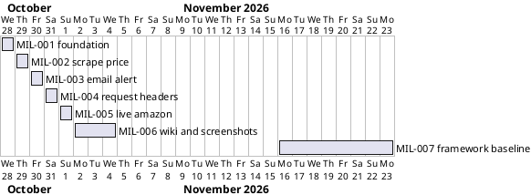

# Project Plan

## Metadata
| Key | Value |
| --- | --- |
| ID | PP-001 |
| CrossReference | [BC-001], [SA-001], [MIL-001], [MIL-002], [MIL-003], [MIL-004], [MIL-005], [MIL-006], [MIL-007] |
| Language | en |
| Domain | education |

## Version History
| Date | Status | Author | Reviewer | Change | Commit |
| --- | --- | --- | --- | --- | --- |
| 2026-10-28 | Deprecated | Jens Tirsvad Nielsen | AI as stand-in for S01 | Initial version Accepted after review (RC-003 Go) | [f9765fd] |
| 2026-11-16 | Accepted | Jens Tirsvad Nielsen | AI as stand-in for S01 | Added the baseline gateway MIL-007 with its schedule row, scope coverage, dependency, risk and Gantt entries; recorded the move of the end date, the domain and the live-site rule in the Planning Assumptions and Open Issues; set the domain to education; reviewed in autonomous mode, not independent | [8e0d0cf] |

---

## Purpose

Schedule the six gateways (Go/No-Go decision points) that deliver the Day 47 Amazon price tracker, one branch and pull request per gateway, from 2026-10-28 to 2026-11-04, and a seventh, the framework baseline ([MIL-007]), that follows them.

## Planning Assumptions

- Week 1 starts 2026-10-28; the plan ends by 2026-11-04, a soft target for a learning project ([BC-001] has no hard deadline).
- One gateway per day or two; the author is S01 and the AI works as stand-in reviewer in autonomous mode, recorded in each `RC-*`.
- The cadence follows [SA-001]: S01 reviews at each pull request.
- Source of the dates: the author's estimate on 2026-10-28; there is no external deadline. The baseline is first set here, so there is no earlier baseline to record a change against.
- No governance document exists in this project; S01 is Responsible and Accountable for every artifact, and the AI is a recorded stand-in reviewer.
- The baseline gateway MIL-007 starts 2026-11-16 and ends 2026-11-23, one week (source: [BC-001], Constraints). It brings the finished project to the baseline of the framework, a decision of S01; the first six gateways keep their dates, so the end date of the plan moves from 2026-11-04 to 2026-11-23 because of it.
- For MIL-007 S01 has authorised the assistant to commit, push, open the pull request and merge it, and the review is done by an AI stand-in for S01 (source: [BC-001], Constraints and Risks).

## Gateway Schedule

| Gateway | Document | Window | Decision date | Owner | Stories | Main deliverable | Milestone |
| --- | --- | --- | --- | --- | --- | --- | --- |
| MIL-001 | `docs/milestones/mil-001-foundation.md` | 2026-10-28 | 2026-10-28 | S01 | none (technical tasks) | Branch `mil-001-foundation` merged: `pyproject.toml`, `.gitignore`, `.env.example`, `constants.py`, `Doxyfile`, README from the framework template, a passing smoke test, and the repository description and topics on the host. | [Milestone 271](https://git.tirsystem.com/Tirsvad-Udemy-100-days-of-code/047-amazon-price-tracker/milestones/271) |
| MIL-002 | `docs/milestones/mil-002-scrape-price.md` | 2026-10-29 | 2026-10-29 | S01 | none (technical tasks) | Branch `mil-002-scrape-price` merged: a scraper that returns the title and the price as a `float`, a saved copy of the practice page used by tests, a screenshot of the step, and the README section for it. | [Milestone 272](https://git.tirsystem.com/Tirsvad-Udemy-100-days-of-code/047-amazon-price-tracker/milestones/272) |
| MIL-003 | `docs/milestones/mil-003-email-alert.md` | 2026-10-30 | 2026-10-30 | S01 | none (technical tasks) | Branch `mil-003-email-alert` merged: an alert that builds and sends an e-mail with title, price and buy link when the price is below target, with credentials from `.env`, tests with a mocked SMTP server, a screenshot, and the README section. | [Milestone 273](https://git.tirsystem.com/Tirsvad-Udemy-100-days-of-code/047-amazon-price-tracker/milestones/273) |
| MIL-004 | `docs/milestones/mil-004-request-headers.md` | 2026-10-31 | 2026-10-31 | S01 | none (technical tasks) | Branch `mil-004-request-headers` merged: requests carry the headers from `constants.py`, tests prove it, a screenshot and a README section. | [Milestone 274](https://git.tirsystem.com/Tirsvad-Udemy-100-days-of-code/047-amazon-price-tracker/milestones/274) |
| MIL-005 | `docs/milestones/mil-005-live-amazon.md` | 2026-11-01 | 2026-11-01 | S01 | none (technical tasks) | Branch `mil-005-live-amazon` merged: URL and selectors configurable for the live page, a detection of a CAPTCHA page with a clear message, tests, a screenshot of the result, and the README section including the limits. | [Milestone 275](https://git.tirsystem.com/Tirsvad-Udemy-100-days-of-code/047-amazon-price-tracker/milestones/275) |
| MIL-006 | `docs/milestones/mil-006-wiki-screenshots.md` | 2026-11-02 to 2026-11-04 | 2026-11-04 | S01 | none (technical tasks) | Wiki pages in `en`, `da` and `ms`, one per language per lecture step plus a home page, each explaining what was gained and showing the step screenshot; the wiki is published on the host. | [Milestone 276](https://git.tirsystem.com/Tirsvad-Udemy-100-days-of-code/047-amazon-price-tracker/milestones/276) |
| MIL-007 | `docs/milestones/mil-007-framework-baseline.md` | 2026-11-16 to 2026-11-23 | 2026-11-23 | S01 | none (technical tasks) | Branch `mil-007-baseline` merged: the adopted framework release, the wiki in the framework's shape, the README, licence and project URL metadata, the traceability matrix and review records. | [Milestone 562](https://git.tirsystem.com/Tirsvad-Udemy-100-days-of-code/047-amazon-price-tracker/milestones/562) |

## Timeline diagram

## Scope Coverage

| Business Case scope item | Gateway |
| --- | --- |
| Python 3.13, venv, pyproject, pytest, constants, Doxygen | MIL-001 |
| Step 1: scrape the price | MIL-002 |
| Step 2: e-mail alert and `.env` | MIL-003 |
| Step 3: request headers | MIL-004 |
| Step 4: live Amazon page | MIL-005 |
| README (MIL-001 and each step) and the three-language wiki | MIL-001 to MIL-006 |
| The baseline: framework release, wiki shape, README, licence and project URL metadata, traceability matrix, review records | MIL-007 |

## Dependencies

MIL-001 → MIL-002 → MIL-003 → MIL-004 → MIL-005 → MIL-006 → MIL-007. A No-Go stops the chain: later windows move by the rework time. S01 decides whether the end date moves; for MIL-007 it moved from 2026-11-04 to 2026-11-23.

## Plan Risks

| Risk | Mitigation |
| --- | --- |
| Gitea wiki disabled or not pushable | MIL-006 stops and reports; pages stay in `docs/wiki/` |
| Amazon blocks the live request (from [BC-001] risk 1) | MIL-005 documents the outcome; it does not bypass the block |
| A continuous integration (CI) check fails on the pull request of MIL-007 | The merge is delayed past 2026-11-23 | The failure is fixed on the same branch and the checks run again; after three failed rounds on one cause the work stops and S01 decides (trace: success criterion 7 of [BC-001]) |

## Open Issues

- Wiki publishing path depends on the host (checked in MIL-006).
- The e-mail screenshot is rendered from the message the code builds, not from a delivered mail.

- The Gateway Schedule links the milestones of the git host that existed; the baseline milestone is linked after the sync.
- Domain: since [MIL-007] the plan, the Business Case and the baseline milestone have the domain `education`. The other documents (Stakeholder Analysis, milestones MIL-001 to MIL-006 and the review records RC-001 to RC-014) keep the domain `it` they were accepted with; they are not changed by the baseline, and a change of their domain would need a new review of each.
- Live services: the bot requests a product page and sends e-mail only when a command is run on purpose, with the author's own `.env`; the tests use saved pages and a fake mail connection. MIL-007 requests no page of a shop site and sends no e-mail. Automated access to a shop site may be against that site's terms of use; the reader checks the terms of the site before running the bot against it, and the bot does not try to get past a robot check.

---

[BC-001]: ./business-case.md
[SA-001]: ./stakeholder-analysis.md
[f9765fd]: https://git.tirsystem.com/Tirsvad-Udemy-100-days-of-code/047-amazon-price-tracker/commit/f9765fd3743f46c189359e713fd050c8e1a598b6
[MIL-001]: ./milestones/mil-001-foundation.md
[MIL-002]: ./milestones/mil-002-scrape-price.md
[MIL-003]: ./milestones/mil-003-email-alert.md
[MIL-004]: ./milestones/mil-004-request-headers.md
[MIL-005]: ./milestones/mil-005-live-amazon.md
[MIL-006]: ./milestones/mil-006-wiki-screenshots.md
[MIL-007]: ./milestones/mil-007-framework-baseline.md
[8e0d0cf]: https://git.tirsystem.com/Tirsvad-Udemy-100-days-of-code/047-amazon-price-tracker/commit/8e0d0cf1a04f59b594b6f7ece460568df08225d1
