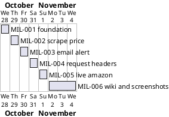

# Project Plan

## Metadata
| Key | Value |
| --- | --- |
| ID | PP-001 |
| CrossReference | [BC-001], [SA-001] |
| Language | en |
| Domain | it |

## Version History
| Date | Status | Author | Reviewer | Change | Commit |
| --- | --- | --- | --- | --- | --- |
| 2026-10-28 | Accepted | Jens Tirsvad Nielsen | AI as stand-in for S01 | Initial version Accepted after review (RC-003 Go) | pending |

---

## Purpose

Schedule the six gateways (Go/No-Go decision points) that deliver the Day 47 Amazon price tracker, one branch and pull request per gateway, from 2026-10-28 to 2026-11-04.

## Planning Assumptions

- Week 1 starts 2026-10-28; the plan ends by 2026-11-04, a soft target for a learning project ([BC-001] has no hard deadline).
- One gateway per day or two; the author is S01 and the AI works as stand-in reviewer in autonomous mode, recorded in each `RC-*`.
- The cadence follows [SA-001]: S01 reviews at each pull request.
- Source of the dates: the author's estimate on 2026-10-28; there is no external deadline. The baseline is first set here, so there is no earlier baseline to record a change against.
- No governance document exists in this project; S01 is Responsible and Accountable for every artifact, and the AI is a recorded stand-in reviewer.

## Gateway Schedule

| Gateway | Document | Window | Decision date | Owner | Stories | Main deliverable | Milestone |
| --- | --- | --- | --- | --- | --- | --- | --- |
| MIL-001 | `docs/milestones/mil-001-foundation.md` | 2026-10-28 | 2026-10-28 | S01 | none (technical tasks) | Branch `mil-001-foundation` merged: `pyproject.toml`, `.gitignore`, `.env.example`, `constants.py`, `Doxyfile`, README from the framework template, a passing smoke test, and the repository description and topics on the host. | not yet synced |
| MIL-002 | `docs/milestones/mil-002-scrape-price.md` | 2026-10-29 | 2026-10-29 | S01 | none (technical tasks) | Branch `mil-002-scrape-price` merged: a scraper that returns the title and the price as a `float`, a saved copy of the practice page used by tests, a screenshot of the step, and the README section for it. | not yet synced |
| MIL-003 | `docs/milestones/mil-003-email-alert.md` | 2026-10-30 | 2026-10-30 | S01 | none (technical tasks) | Branch `mil-003-email-alert` merged: an alert that builds and sends an e-mail with title, price and buy link when the price is below target, with credentials from `.env`, tests with a mocked SMTP server, a screenshot, and the README section. | not yet synced |
| MIL-004 | `docs/milestones/mil-004-request-headers.md` | 2026-10-31 | 2026-10-31 | S01 | none (technical tasks) | Branch `mil-004-request-headers` merged: requests carry the headers from `constants.py`, tests prove it, a screenshot and a README section. | not yet synced |
| MIL-005 | `docs/milestones/mil-005-live-amazon.md` | 2026-11-01 | 2026-11-01 | S01 | none (technical tasks) | Branch `mil-005-live-amazon` merged: URL and selectors configurable for the live page, a detection of a CAPTCHA page with a clear message, tests, a screenshot of the result, and the README section including the limits. | not yet synced |
| MIL-006 | `docs/milestones/mil-006-wiki-screenshots.md` | 2026-11-02 to 2026-11-04 | 2026-11-04 | S01 | none (technical tasks) | Wiki pages in `en`, `da` and `ms`, one per language per lecture step plus a home page, each explaining what was gained and showing the step screenshot; the wiki is published on the host. | not yet synced |

## Timeline diagram

## Scope Coverage

| Business Case scope item | Gateway |
| --- | --- |
| Python 3.13, venv, pyproject, pytest, constants, Doxygen | MIL-001 |
| Step 1: scrape the price | MIL-002 |
| Step 2: e-mail alert and `.env` | MIL-003 |
| Step 3: request headers | MIL-004 |
| Step 4: live Amazon page | MIL-005 |
| README (MIL-001 and each step) and the three-language wiki | MIL-001 to MIL-006 |

## Dependencies

MIL-001 → MIL-002 → MIL-003 → MIL-004 → MIL-005 → MIL-006. A No-Go stops the chain: later windows move by the rework time. S01 decides whether the end date 2026-11-04 moves.

## Plan Risks

| Risk | Mitigation |
| --- | --- |
| Gitea wiki disabled or not pushable | MIL-006 stops and reports; pages stay in `docs/wiki/` |
| Amazon blocks the live request (from [BC-001] risk 1) | MIL-005 documents the outcome; it does not bypass the block |

## Open Issues

- Wiki publishing path depends on the host (checked in MIL-006).
- The e-mail screenshot is rendered from the message the code builds, not from a delivered mail.

---

[BC-001]: ./business-case.md
[SA-001]: ./stakeholder-analysis.md
